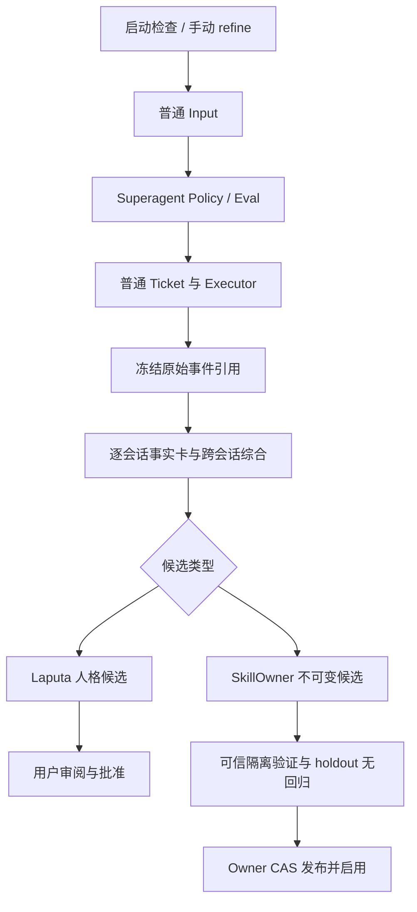

# AutoDream 与手动 refine

AutoDream 由 `dsh-evolution` 在运行时启动就绪后检查一次。默认要求距离上次完成的自动或手动精炼至少 24 小时，并且有至少 5 个新增会话、10 条去重的一手事件。设置位于「进化 → AutoDream」。插件热重载不重复触发，也没有常驻轮询。

满足条件只会提交普通 Superagent Input。自动请求的 `human` 为 `false`；Policy 可以拒绝或延迟。只有普通 Executor 获得运行中的 Ticket 后，才能调用 `scripts/dream-refine.mjs` 处理该请求。手动 refine 跳过数量和冷却门槛，但使用同一候选与发布流程。

材料来自当前安装 `DSH_HOME` 中 WorkspaceRegistry 登记的会话。只统计已完成轮次的一手用户消息和工具结果，排除继承的重复事件、工作 Agent 与评估会话。事件摘要和进化自己的输出不能单独充当新材料。请求冻结源日志上界和摘要；读取时再次校验，源日志变动则拒绝继续。

## Executor 工作流程

`npm run setup:components` 安装受管理的 `diva-dream` skill；已有同名用户 skill 会被保留并报告冲突。请求正文提供本安装 CLI 的绝对路径。

依次调用 `claim`、`evidence`、`baseline`、`plan --file <JSON>`、`execute`，均携带 `--request <请求 ID> --ticket <实际 Ticket ID>`，并继承绝对 `DSH_HOME`。计划格式见 [diva-dream](../skills/diva-dream/SKILL.md)。Ticket 必须实际关联该请求的 Input，且仍有运行中的 Assignment；填写一个 Ticket ID 本身不构成授权。

不产生修改也可以完成：提交实际分析过的事实卡和 coverage，以及空候选数组。成功无修改也更新冷却时间。验证阻塞不会伪装为完成；部分候选已发布时保留其回执，重试先对账，避免重复写入。调度、取消和恢复仍归 Superagent，Dream 只记录业务阶段。

## 人格候选

候选由 Laputa 保存，不写入可编辑草稿，也不初始化或启用人格。用户在「人格 → 提案」查看来源、差异与基线，明确确认后批准发布，或者拒绝。批准会校验草稿摘要与正式版本是否仍匹配；冲突需要重新生成提案。旧会话继续使用固定版本，新会话读取批准后的版本。

## 技能验证与部署

候选和验证产物放在 Harness owner 状态目录，位于技能发现目录之外。发布后 provider 指向按摘要保存的不可变版本，正文与相对资源来自同一 bundle。用户拥有的同名文件系统技能不可覆盖。

真实验证需要部署者提供可信测试套件与运行环境。套件不由候选或模型提交：包含 mandatory 用例、独立冻结的 holdout 用例、策略版本、固定摘要的 Linux OCI 镜像和超时。详细字段与 owner 路径见 [Harness 验证部署说明](../plugins/dsh-continual-harness/docs/skill-owner.md)。

所有 mandatory 用例必须通过，holdout 必须相对当前正式版本无回归；不要求统计显著提升。验证绑定候选、基线、套件、环境和策略摘要，发布还要再次检查实际 Ticket 与 CAS 基线。调用方提交 `passed` 或通用进化记录中的验证结果不能赋予发布权限。

缺少 Docker、镜像、测试套件、完整执行结果时状态为 blocked。生产目录不会被用作隔离执行的回退位置。当前机器尚未配置 Docker，因此这里不声称已完成真实脚本验证或自动发布。
