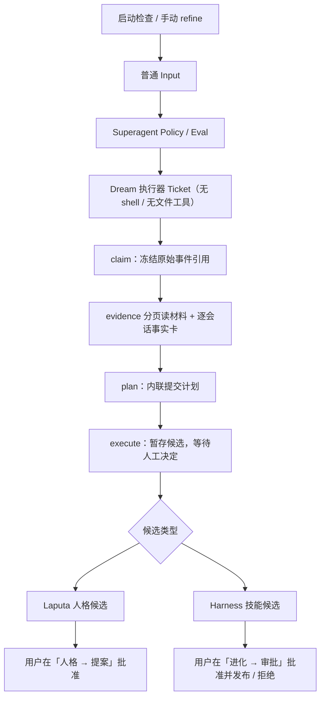

# AutoDream 与手动 refine

AutoDream 由 `dsh-evolution` 在运行时启动就绪后检查一次。默认要求距离上次完成的自动或手动精炼至少 24 小时，并且有至少 5 个新增会话、10 条去重的一手事件。设置位于「进化 → AutoDream」。插件热重载不重复触发，也没有常驻轮询。

满足条件只会提交普通 Superagent Input。自动请求的 `human` 为 `false`；Policy 可以拒绝或延迟。只有拿到运行中 Ticket 的 Dream 执行器才能处理该请求：它是一个没有 shell、没有文件工具的专用执行模式，只用 `dream_refine` 工具读冻结材料并提交计划（见 [Dream 执行器](dream-executor.md)）。手动 refine 跳过数量和冷却门槛，但使用同一候选与批准流程。

**没有任何自动发布路径。** 人格与技能候选都只在用户明确确认后才生效；两者都不做自动验证。技能验证环境如何提供仍是待决策项（见 `TODOLIST.md` 的 DV-EV-014），在决策前不引入 Docker 或 Python 服务依赖。

材料来自当前安装 `DSH_HOME` 中 WorkspaceRegistry 登记的会话。只统计已完成轮次的一手用户消息和工具结果，排除继承的重复事件、工作 Agent 与评估会话。事件摘要和进化自己的输出不能单独充当新材料。请求冻结源日志上界和摘要；读取时再次校验，源日志变动则拒绝继续。

## Executor 工作流程

`npm run setup:components` 安装受管理的 `diva-dream` skill；已有同名用户 skill 会被保留并报告冲突。Input 正文只说明用哪个工具，不再给 CLI 路径。

Dream 执行器按顺序调用 `dream_refine` 的六个命令：`claim`、`evidence`、`baseline`、`plan`、`execute`、`status`。工具自己解析 Ticket → 起源 Input → 冻结请求，模型不需要也不允许传请求 ID 或 Ticket ID；每次调用都由 `authorize()` 复核 Ticket 存活、主体和归属。

- `claim` 只返回每会话的引用条数，不返回材料本身。
- `evidence` 不带 `session` 时列出会话；带 `session/offset/limit` 返回一页引用（默认 30，最多 80），带 `ref` 返回单条事件全文（≤6 kB）。材料按请求缓存在内存里，分页不会重复扫描 4 MB。
- `plan` 直接接收计划对象，写入日志后由所有者暂存候选；计划在接受后不可变。
- `execute` 只把候选交给所有者，然后进入等待人工批准；它不会验证、不会发布、也不会写入可发现的技能目录。

计划格式见 [diva-dream](../skills/diva-dream/SKILL.md)，执行模式边界见 [Dream 执行器](dream-executor.md)。Ticket 必须实际关联该请求的 Input，且仍有运行中的 Assignment。不产生修改也可以完成：提交实际分析过的事实卡和 coverage，以及空候选数组。成功无修改也更新冷却时间。调度、取消和恢复归 Superagent，Dream 只记录业务阶段。`scripts/dream-refine.mjs` 保留给有 shell 的人调试，不再下发给 Dream 会话。

## 技能候选的批准

技能候选保存在 `$DSH_HOME/harness/skill-owner`，位于技能发现目录之外。批准界面在「进化 → 审批」标签的待批列表里：展示技能 ID、来源工单、证据引用、与当前版本的逐行差异（`SKILL.md` 与附件分别展示）、附件全文，以及「批准并发布」「拒绝」。

- 批准与发布是一次提交：先写发布状态，再写不可变的批准回执。发布失败（例如基线已被别的版本推进）时什么都不记录，候选留在待批列表；不会出现「已批准但不可见」的候选。
- 发布前再次校验审阅时的 bundle 摘要仍与候选一致；成功即发布，provider 以 rank 390 让新版本对所有会话可见；已列出的旧定位器继续读旧版本。
- 拒绝记录在案，候选作废；再想改动需要新的候选。已处置的候选（含拒绝）保留在「已处置」列表，批准但未发布的可以重试。
- 一次批准只能发布一次；同一候选不能改判。
- 回滚入口在「已发布的 harness 技能」里：点「回滚到上一版」只生成一个回滚候选，仍需同样的批准才会生效。
- 用户自己拥有的同名技能不会被覆盖，发布直接拒绝。

审批记录当前不写入 Evolution 记录库（`/evidence`、`/proposal` 等没有运行时生产者）；技能批准记录在 owner 的 `decisions/` 与「已处置」，人格提案记录在 Laputa 的候选目录。「进化 → 进化记录」页的空态也据此说明。

## 人格候选

候选由 Laputa 保存，不初始化或启用人格。用户在「人格 → 提案」查看来源、差异与基线，明确确认后批准发布，或者拒绝。

- 批准会校验草稿摘要与正式版本是否仍匹配；冲突需要重新生成提案。
- 批准成功后，若草稿仍是提案生成时的内容（没有并行的手工编辑），草稿会被同步为已发布内容，避免「发布草稿」把人格静默退回旧版本；若草稿里有手工编辑，则保留编辑并提示「未覆盖」。
- 发布旧内容会被拒绝（`persona_draft_stale`）：草稿等于某个非当前版本时，请用「版本 → 回滚」恢复，而不是直接发布。
- 旧会话继续使用固定版本，新会话读取批准后的版本。
